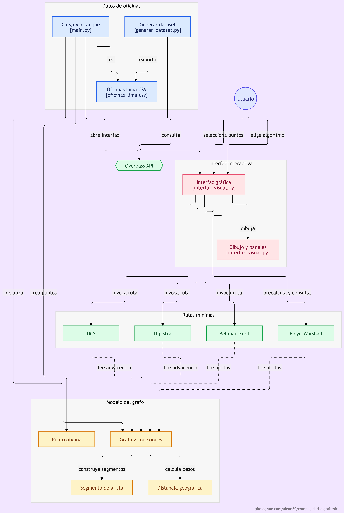

# Complejidad Algorítmica

[](https://www.python.org/)
[](https://pandas.pydata.org/)
[](https://matplotlib.org/)

> Proyecto del Grupo 1 para modelar oficinas y puntos de interés de Lima mediante un grafo, visualizar sus conexiones y calcular rutas mínimas entre puntos.

## 👥 Integrantes

| Integrante |
| --- |
| Leon Ojeda, Adrian Alejandro |
| Huarancca Evangelista, Duval Paul |
| Quispe Serrano, Julio Frank |

---

## 📝 Caso de estudio

**Caso 1: Optimización de rutas de reparto en logística urbana**

El sistema representa ubicaciones reales de Lima como vértices de un grafo. Cada oficina se conecta con sus vecinos más cercanos y las aristas usan la distancia geográfica Haversine en kilómetros como peso.

| Aplicaciones reales | Objetivo |
| --- | --- |
| UPS | Reducir tiempo y costo de las rutas |
| Rappi | Optimizar recorridos de reparto urbano |

### Algoritmos implementados

| Algoritmo | Tipo | Complejidad sobre vértices `V` y aristas `E` |
| --- | --- | --- |
| UCS | Exploración con cola de prioridad | `O((V + E) log V)` |
| Dijkstra | Camino mínimo con pesos no negativos | `O((V + E) log V)` |
| Bellman-Ford | Caminos mínimos con relajación iterativa | `O(V × E)` |
| Floyd-Warshall | Matrices de caminos mínimos entre todos los pares, con precálculo manual | `O(V³)` |

---

## 📊 Dataset

El archivo `oficinas_lima.csv` incluye hasta 1500 oficinas obtenidas dentro del área aproximada de Lima. Algunos campos pueden estar vacíos según la información disponible en OpenStreetMap.

| Columna | Descripción |
| --- | --- |
| `name` | Nombre de la oficina |
| `type` | Categoría de la oficina |
| `district` | Distrito o zona aproximada |
| `email` | Correo de contacto |
| `opening_hours` | Horario de atención |
| `phone` | Número de teléfono |
| `lat` | Latitud |
| `lon` | Longitud |

---

## 🤔 Cómo funciona

1. `generar_dataset.py` consulta **Overpass API** para obtener oficinas de Lima.
2. El CSV conserva hasta 1500 oficinas únicas con nombre y coordenadas.
3. `main.py` carga todos los campos del CSV y asigna la longitud a `x` y la latitud a `y`.
4. Se conservan las coordenadas geográficas originales; la interfaz ajusta la escala horizontal según la latitud media para representar correctamente las distancias en el mapa.
5. `Grafo_algoritmos.py` crea los vértices, las aristas y ofrece los algoritmos de rutas.
6. `interfaz_visual.py` dibuja el grafo con Matplotlib; el usuario elige UCS, Dijkstra, Bellman-Ford o Floyd-Warshall y selecciona los puntos de origen y destino.

<p align="center">
  
</p>

---

## 📂 Estructura del proyecto

```text
Complejidad-Algoritmica/
├── main.py                    # Carga el dataset y ejecuta la visualización
├── Grafo_algoritmos.py        # Punto, arista, grafo y algoritmos de rutas
├── interfaz_visual.py         # Interfaz y visualización interactiva del grafo
├── requirements.txt           # Dependencias de Python
├── README.md                  # Documentación del proyecto
├── assets/
│   └── diagrama_flujo_proyecto.png
└── dataset/
    ├── generar_dataset.py     # Genera el CSV desde OpenStreetMap
    └── oficinas_lima.csv      # 1500 registros de oficinas
```

### Responsabilidad de cada archivo

- **`main.py`** — lee el dataset con Pandas, usa longitud como `x` y latitud como `y`, y crea una instancia de `Grafo`.
- **`Grafo_algoritmos.py`** — define `Punto` (con los datos de cada oficina), `Arista` y `Grafo`; genera las aristas y ofrece los algoritmos de rutas.
- **`interfaz_visual.py`** — define `dibujar_grafo(grafo)` y contiene los controles, el dibujo y la interacción de Matplotlib.
- **`generar_dataset.py`** — consulta tres servidores de Overpass, valida los registros y exporta el CSV.
- **`oficinas_lima.csv`** — contiene nombres, tipos, distritos, contacto y coordenadas geográficas.

---

## 🔧 Requisitos

- Python **3.11** o superior
- Entorno gráfico compatible con Matplotlib

| Librería | Uso |
| --- | --- |
| `pandas` | Lectura y preparación del CSV |
| `numpy` | Coordenadas y cálculos de segmentos |
| `matplotlib` | Renderizado interactivo del grafo |
| `requests` | Consulta de OpenStreetMap desde el generador |

## 💾 Instalación y ejecución

### Instalación de dependencias

```powershell
python -m pip install -r requirements.txt
```

### Ejecución del archivo principal

```bash
python main.py
```

Se abre una ventana de Matplotlib con todas las ubicaciones. Los puntos morados representan las oficinas y las conexiones representan relaciones con los vecinos cercanos. Para usar Floyd-Warshall, pulsa **Precalcular Floyd-Warshall** en la parte superior derecha; la interfaz avisa que demora aproximadamente 16 segundos y muestra solo el tiempo real al terminar. El botón permanece visible, pero se desactiva tras el precálculo. Luego selecciona uno de los cuatro algoritmos y haz clic en los puntos de origen y destino para visualizar el camino mínimo en un recuadro fijo que ajusta el tamaño del texto según la longitud de la ruta, su tiempo de ejecución y la información de contacto de ambos puntos en el panel lateral.

### Regenerar el dataset

```bash
python dataset/generar_dataset.py
```

El script intenta varios servidores de Overpass y reemplaza `dataset/oficinas_lima.csv`. Esta operación requiere conexión a Internet.

## Recursos del proyecto

- [Informe grupal](https://docs.google.com/document/d/1iFfdhpS1B9t0JLK-5X4ryxJ0kjc8Zn6g/edit?usp=sharing&ouid=102863531412755059126&rtpof=true&sd=true)
- Presentación: *pendiente de agregar el enlace de Canva*
